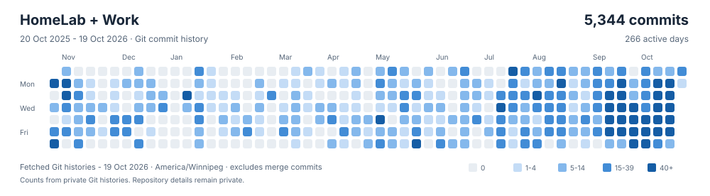

# Pavlo Barzdun

I build laboratory automation, self-hosted infrastructure, and robotics systems.
Much of my work lives on private, self-hosted Git servers.

## HomeLab + Work

This calendar shows my authored commits from HomeLab and work Git histories over the past 365 days.
Each non-merge commit is counted once across repositories, using its original author date in America/Winnipeg.

Snapshot: 19 October 2026. Repository details remain private.
This chart is separate from GitHub's contribution calendar.
